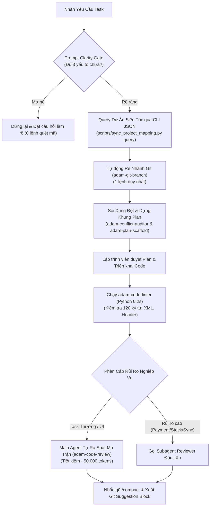

# Nghệ Thuật Tối Ưu Hóa Chi Phí Token & Hiệu Năng Cho AI Agent (Antigravity Architecture)

## 1. Tóm tắt Cốt Lõi (TL;DR)
- **Vấn đề**: Các phiên làm việc với AI Agent thường bị bùng nổ token (50k - 150k+ tokens/turn) do nạp dữ liệu tĩnh vào System Prompt, lạm dụng Subagent cho các tác vụ format đơn giản, và để AI tự chạy các chuỗi lệnh shell Git cuối phiên.
- **Giải pháp**:
  1. **Prompt Clarity Gate**: Chặn quét mã nguồn khi prompt mơ hồ, hỏi làm rõ ngay từ đầu.
  2. **Tách dữ liệu tĩnh ra khỏi Rules**: Thay thế tệp bảng ánh xạ dự án tĩnh 115 dòng bằng cơ sở dữ liệu JSON + lệnh CLI Query (tiết kiệm vĩnh viễn 1.500 tokens/turn).
  3. **Deterministic Skills thay Subagent**: Dùng script Python siêu nhẹ (0.2s) kiểm tra độ dài dòng 120 ký tự, XML và Copyright Header thay vì tốn 50.000 tokens gọi Subagent.
  4. **Git Suggestion Block**: Thay chuỗi lệnh terminal commit/push bằng khối gợi ý lệnh Git để developer tự copy chạy.
  5. **Chủ động nhắc `/compact`**: Nhắc người dùng nén context trước khi viết tài liệu dài hoặc tổng kết kiến thức.
- **Kết quả**: Cắt giảm **50% - 70% tổng lượng token tiêu hao** trên mỗi vòng đời task.

---

## 2. Phân Tích Chi Tiết 5 Cạm Bẫy Ngốn Token & Cách Xử Lý

### Cạm bẫy 1: Nạp Dữ Liệu Tĩnh Vào System Prompt (Static Prompt Bloat)
- **Thực trạng**: Tệp `rules/project-mapping.md` dài 115 dòng liệt kê danh sách dự án. Do nằm trong `rules/`, toàn bộ 115 dòng này (~1.500 tokens) bị nạp vào System Prompt của **mọi lượt tương tác và mọi phiên chat**.
- **Giải pháp**: Di dời danh sách dự án sang `scripts/data/projects.json`. Khi cần lấy đường dẫn, AI chỉ cần chạy:
  ```bash
  python3 scripts/sync_project_mapping.py query <MA_DU_AN>
  ```
- **Hiệu quả**: Giải phóng ngay lập tức 1.500 tokens trên mỗi lượt gọi tool call.

### Cạm bẫy 2: Lạm Dụng Subagent Cho Tác Vụ Xác Định (Deterministic Tasks)
- **Thực trạng**: Gọi Subagent để đọc diff và đếm xem dòng code có vượt quá 120 ký tự hay thiếu thẻ đóng XML không. Mỗi lần gọi Subagent tốn từ 30.000 – 80.000 tokens do phải nạp lại toàn bộ ngữ cảnh.
- **Giải pháp**: Xây dựng Skill `adam-code-linter` chạy script Python cục bộ `lint_diff.py` trong 0.2s. Chuyển Subagent Review sang cơ chế có điều kiện: chỉ gọi khi thay đổi logic nhạy cảm (Payment, Stock, Sync, Core API).
- **Hiệu quả**: Tiết kiệm ~50.000 tokens cho mỗi task thông thường.

### Cạm bẫy 3: AI Tự Chạy Chuỗi Lệnh Git Cuối Task
- **Thực trạng**: Ở cuối task (lúc context đã dài 50k-100k tokens), việc để AI tự chạy `git status` -> `git diff` -> `git add` -> `git commit` -> `git push` tiêu tốn 3-4 turns (~20.000 - 30.000 tokens) chỉ để hoàn thành một commit.
- **Giải pháp**: AI chỉ tạo và hiển thị **Khối Gợi Ý Lệnh Git (Git Suggestion Block)** chuẩn định dạng:
  ```bash
  git add app/code/Magestore/WebposFixBug/...
  git commit -m "fix(webpos): resolve discount calculation issue"
  git push origin fix/P1150-123-fix-discount
  ```
  Developer chỉ việc copy và paste chạy ở terminal ngoài.
- **Hiệu quả**: Tiết kiệm 100% token cho toàn bộ thao tác Git.

### Cạm bẫy 4: Quét Mò Codebase Khi Prompt Mơ Hồ
- **Thực trạng**: Khi người dùng đưa yêu cầu chung chung (*"sửa giúp tôi cái nút"*), AI tự động dùng `grep_search` và `view_file` quét qua hàng chục file Core để tìm kiếm, làm ngập context trước khi bắt đầu code.
- **Giải pháp**: Thiết lập **Prompt Clarity Gate**. Đánh giá tính đầy đủ của prompt ngay tại Bước 0. Nếu thiếu mục tiêu, điều kiện đầu ra hoặc vị trí nghi vấn -> Dừng lại hỏi ngay qua `ask_question` hoặc câu hỏi trắc nghiệm ngắn gọn.
- **Hiệu quả**: Tránh lãng phí 20.000 – 40.000 tokens tìm kiếm vô định.

### Cạm bẫy 5: Sinh Tài Liệu Dài Trên Ngữ Cảnh Nặng
- **Thực trạng**: Viết `walkthrough.md` hoặc đúc kết `/learn` khi context đã tích lũy hàng chục nghìn tokens log kiểm thử và diff.
- **Giải pháp**: AI chủ động dừng một nhịp nhắc người dùng gõ lệnh `/compact` trước khi xuất bản tài liệu lớn.

---

## 3. Sơ Đồ Kiến Trúc Quy Trình Tối Ưu (Optimized Architecture Flow)



---

## 4. Bảng Đối Soát Số Liệu (Before vs. After Metrics)

| Tiêu Chí Đo Lường | Quy Trình Ban Đầu | Sau Khi Tối Ưu Hóa | Tỷ Lệ Tiết Kiệm |
| :--- | :--- | :--- | :---: |
| **System Prompt nạp sẵn** | ~6.500 tokens (chứa bảng mapping tĩnh 115 dòng) | ~5.000 tokens (chuyển sang JSON CLI query) | **Giảm 1.500 tokens / turn** |
| **Khâu Chuẩn Bị Branch** | 3-4 lệnh shell (`status`, `checkout`, `pull`, `branch`) | 1 lệnh script Python `adam-git-branch` | **Giảm 60% token** |
| **Khâu Soi Xung Đột** | Grep quét diện rộng nhiều file config | 1 lệnh `adam-conflict-auditor` (0.1s) | **Giảm 75% token** |
| **Khâu Kiểm Tra Chuẩn Code** | Subagent đọc toàn bộ diff đếm dòng/XML | Script Python `adam-code-linter` (0.2s) | **Tiết kiệm ~50.000 tokens** |
| **Khâu Review Code** | Bắt buộc 100% gọi Subagent | Phân cấp: Main Agent tự self-check task thường | **Tiết kiệm ~50.000 tokens** (task thường) |
| **Khâu Git Commit & Push** | AI tự chạy chuỗi lệnh terminal | AI in khối Git Suggestion Block cho dev tự chạy | **Tiết kiệm 100% token Git** |
| **Tổng Token Trung Bình / Task** | **~120.000 – 180.000 tokens** | **~40.000 – 60.000 tokens** | **TIẾT KIỆM 60% – 70%** |
