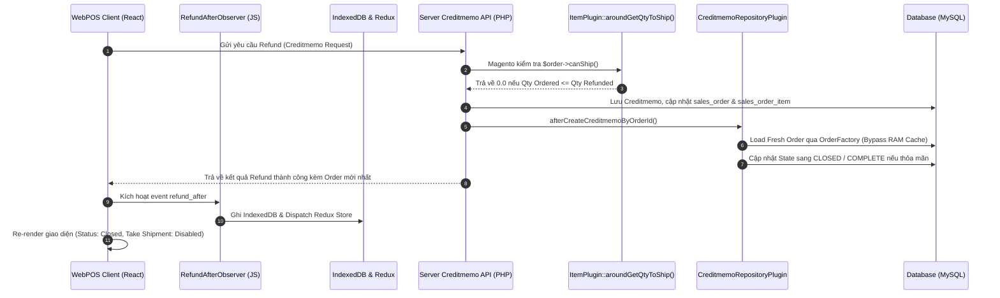

# Xử lý Hoàn tiền Đơn hàng (Creditmemo), Trạng thái Order State Machine và Tránh Stale RAM Cache trong Magento 2

## 1. Tóm tắt Nghiệp vụ Cốt lõi (TL;DR)
- Khi thực hiện hoàn tiền (Creditmemo / Refund) cho đơn hàng trên WebPOS, Magento 2 sẽ kiểm tra xem đơn hàng đã hoàn tất mọi công đoạn chưa (đã giao hết / hủy hết / hoàn hết tiền).
- Nếu một Plugin can thiệp vào `Item::getQtyToShip()` mà không kiểm tra điều kiện hoàn (`qty_ordered <= qty_refunded + qty_canceled`), method sẽ trả về `qty_to_ship > 0`, làm cho `$order->canShip()` vẫn trả về `true` $\rightarrow$ Magento không thể tự động chuyển trạng thái đơn hàng sang `closed`.
- Ngoài ra, `OrderRepository::get($orderId)` giữ cache đối tượng `$order` trong RAM (`OrderRepository::$registry`). Nếu query qua repository sau khi Creditmemo được lưu, entity trả về sẽ có dữ liệu cũ $\rightarrow$ Bắt buộc dùng `OrderFactory::create()->load($orderId)` để đọc trạng thái chính xác và đồng bộ về client.

---

## 2. Bản đồ Mã Nguồn & Điểm Kích Hoạt (Code Tracing & File Anchors)

### Backend (Magento 2 PHP)
- `Magestore\StaffCommission\Plugin\Model\Sales\Order\ItemPlugin::aroundGetQtyToShip()`:
  - Kiểm tra điều kiện biên: nếu `qty_ordered <= qty_refunded + qty_canceled`, lập tức trả về `0.0`.
  - Áp dụng trần: `maxPossibleToShip = max(0, qty_ordered - qty_refunded - qty_canceled)`.
- `Magestore\StaffCommission\Plugin\Model\Sales\Order\CreditmemoRepositoryPlugin::processRefundCommissionAndStatus()`:
  - Bắt cả 2 luồng: Realtime REST API (`afterCreateCreditmemoByOrderId`) và Offline Queue Sync (`afterProcessCreditmemoRequest`).
  - Sử dụng `OrderFactory::create()->load($orderId)` để tránh stale entity registry cache.
  - Kiểm tra điều kiện `isFullyRefunded` (`total_refunded >= total_paid` hoặc toàn bộ items đã refund) $\rightarrow$ cập nhật `state = closed`, `status = closed`.

### Frontend (WebPOS React/Redux)
- `ServiceCreditmemoRefundOperationRefundAfterObserver.js`:
  - Đồng bộ ngay lập tức `qty_refunded`, `qty_shipped_refunded`, `qty_non_shipped_refunded` vào item trong IndexedDB (`OrderService.saveToDb(orders, true)`).
  - Dispatch Redux action `syncActionUpdateDataFinish` để UI cập nhật tức thì trạng thái Order và disable nút *Take Shipment* khi không còn hàng để giao.

---

## 3. Luồng Xử Lý & Sơ Đồ Logic (Logic Flow)

---

## 4. Các "Cạm Bẫy" & Trường Hợp Biên Cần Lưu Ý (Edge Cases & Gotchas)
1. **Lỗi Stale Cache `OrderRepository`**:
   - Khi gọi `$orderRepository->get($orderId)`, Magento lấy entity từ RAM cache cũ trước khi save creditmemo. Muốn có state mới nhất sau transaction, luôn dùng `OrderFactory::create()->load($orderId)`.
2. **Lỗi Qty to Ship trả về số dương cho hàng đã hoàn**:
   - Trong custom module (StaffCommission, Dropship, Serial Number...), nếu tính Qty To Ship dựa trên các cột tùy biến (`qty_non_shipped_refunded`) mà không chặn `qty_ordered <= qty_refunded`, order sẽ bị kẹt vĩnh viễn ở `processing`.
3. **Đồng bộ Realtime UI POS**:
   - Khi refund hoàn tất, nếu không dispatch Redux và ghi `saveToDb(..., true)`, màn hình Order Detail và Take Shipment sẽ giữ reference cũ và hiển thị sai số lượng cho đến khi reload trang.

---

## 5. Lịch Sử & Nguồn Gốc Bài Học (Origin & Tickets)
- **Ticket P1146-880**: Fix lỗi đơn hàng sau khi hoàn tiền toàn bộ trên WebPOS bị tự động chuyển từ `closed` về `processing` sau vài giây đồng bộ dữ liệu.
