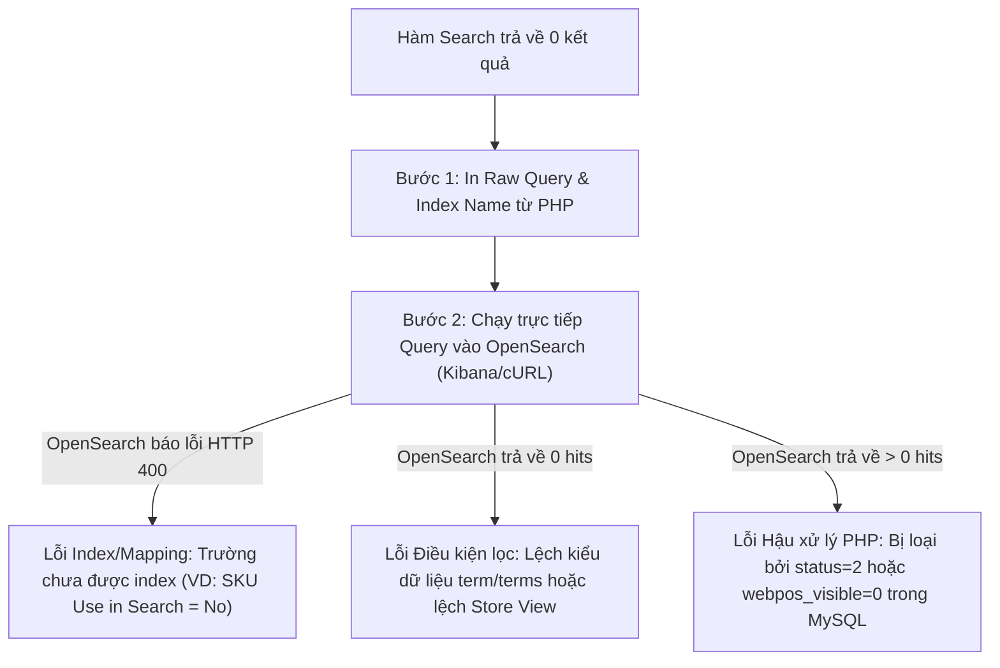

# Hướng dẫn Debug và Xử lý Lỗi OpenSearch / Elasticsearch trong Magento 2 & WebPOS

Tài liệu này cung cấp quy trình 5 bước chuẩn (Playbook) và danh mục các lỗi kinh điển khi phát triển và bảo trì hệ thống tìm kiếm Fulltext Search sử dụng OpenSearch hoặc Elasticsearch trên Magento 2.

---

## 1. Sơ đồ Cây Quyết định (Decision Tree)



---

## 2. Quy trình 5 Bước Debug Nhanh

### Bước 1: In (Dump) câu Query thực tế và Target Index từ PHP
Magento Search Adapter thường tự động `catch` các lỗi HTTP 400 từ OpenSearch và âm thầm trả về `array(0) {}`, làm ta tưởng OpenSearch không tìm thấy. Do đó, bước đầu tiên luôn là lấy ra **Index Name** và **JSON Query Body**.

- Trong Magento 2.4.4+ / 2.4.8: Mở file `vendor/magento/module-open-search/SearchAdapter/Adapter.php` (hoặc `vendor/magento/module-elasticsearch/SearchAdapter/Adapter.php`), tại đầu hàm `query()`:
```php
public function query(\Magento\Framework\Search\RequestInterface $request)
{
    $clientQuery = $this->queryContainerFactory->create(['request' => $request]);

    echo '<pre>';
    echo "1. TARGET INDEX: " . $clientQuery->getIndex() . "\n";
    echo "2. QUERY BODY:\n";
    echo json_encode($clientQuery->getBody(), JSON_PRETTY_PRINT | JSON_UNESCAPED_SLASHES);
    echo '</pre>';
    die();
...
```

---

### Bước 2: Chạy trực tiếp Query vào OpenSearch (Bỏ qua PHP)
Copy đoạn `TARGET INDEX` và `QUERY BODY` ở Bước 1, dán vào **Kibana / OpenSearch Dashboards (Dev Tools)** hoặc dùng **Postman / cURL**:

```http
POST /<TARGET_INDEX>/_search
{
  <Dán toàn bộ QUERY BODY vào đây>
}
```

- **Nếu OpenSearch trả về lỗi HTTP 400 (Exception)** -> Đến **Bước 3** (Lỗi Mapping / Unindexed field).
- **Nếu OpenSearch trả về HTTP 200 nhưng `hits.total.value = 0`** -> Đến **Bước 4** (Lỗi logic điều kiện lọc).
- **Nếu OpenSearch trả về HTTP 200 và CÓ KẾT QUẢ (`hits > 0`)** -> Đến **Bước 5** (Lỗi ở khâu lọc PHP).

---

### Bước 3: Xử lý khi OpenSearch báo lỗi HTTP 400 (Query Shard Exception)
- **Lỗi kinh điển:** `"Cannot search on field [xxx] since it is not indexed."`
  - **Nguyên nhân:** File `search_request.xml` khai báo tìm kiếm qua trường `xxx` (như `sku`, `barcode`), nhưng trong Magento Admin thuộc tính đó đang bị đặt **`Use in Search = No`**, khiến OpenSearch không index trường này.
  - **Khắc phục:** 
    1. Vào **Admin > Stores > Attributes > Product > chọn thuộc tính** -> Bật **`Use in Search = Yes`**.
    2. Chạy: `php bin/magento indexer:reindex webpos_search_product` và `php bin/magento c:f`.

---

### Bước 4: Xử lý khi OpenSearch trả về 0 hits (Lỗi Điều kiện lọc)
Tách câu query thành 2 phần để cô lập điều kiện làm rỗng kết quả:

1. **Test riêng phần `should` (Text match - bỏ qua toàn bộ `must`)**:
   ```json
   POST /<TARGET_INDEX>/_search
   {
     "query": {
       "match": { "name": "Từ khóa tìm kiếm" }
     }
   }
   ```
   - Nếu ra kết quả -> Text match hoạt động tốt, lỗi chắc chắn nằm ở khối **`must`**.
   - Nếu vẫn không ra -> Xem `GET /<TARGET_INDEX>/_mapping/field/name`. Nếu `type` là `"keyword"` thay vì `"text"` thì OpenSearch không tách từ được.

2. **Kiểm tra từng filter trong khối `must`**:
   - **`stock_id`**: Kiểm tra xem `stock_id` trong mapping là `keyword` hay `text`. Nếu là `text` mà query dùng `term: {"stock_id": "1"}` thì sẽ bị fail.
   - **`type_id`**: Kiểm tra xem `type_id` có bị map thành `text` không.
   - **`store_id` (Scope Dimension)**: Kiểm tra xem sản phẩm có nằm đúng Store View mà POS đang query (`_scope1` hay `_scope2`) hay không.

3. **Xem trực tiếp document mẫu của sản phẩm trong OpenSearch**:
   ```http
   GET /<TARGET_INDEX>/_doc/<PRODUCT_ID>
   ```
   Kiểm tra trường `_source` xem có đủ: `"status": "1"`, `"webpos_visible": "1"`, `"stock_id": ["1"]`, `"name": "..."` hay không.

---

### Bước 5: Xử lý khi OpenSearch trả về > 0 nhưng WebPOS trả về rỗng (Lỗi PHP Post-processing)
Sau khi OpenSearch trả về danh sách ID, WebPOS chạy qua hàm `getListProductFromSearchEngineResult` và `checkProductId`.

Đặt dump kiểm tra dữ liệu trong MySQL:
```php
$product = $productRepository->getById($productId);
var_dump($product->getData('webpos_visible')); // Phải là 1
var_dump($product->getStatus());              // Phải là 1 (Enabled)
```
- Nếu `webpos_visible` hoặc `status` trong MySQL của Store View hiện tại là `0` / `2` -> PHP sẽ `unset` sản phẩm khỏi kết quả cuối cùng.

---

## 3. Checklist Các Nguyên Nhân Thường Gặp Nhất

| # | Triệu chứng | Nguyên nhân gốc rễ | Cách xử lý |
|---|---|---|---|
| 1 | Lỗi HTTP 400 `Cannot search on field [sku]` | Thuộc tính `sku` đặt `Use in Search = No` | Bật `Use in Search = Yes` cho `sku` và Reindex |
| 2 | `term` query `stock_id` không khớp | `stock_id` bị khai báo `INTERNAL_DATA_TYPE_STRING` dẫn đến map thành `text` | Đổi sang `INTERNAL_DATA_TYPE_KEYWORD` trong `StaticField.php` |
| 3 | `terms` query `type_id` không khớp | `type_id` bị map thành `text` | Đổi sang `INTERNAL_DATA_TYPE_KEYWORD` trong `StaticField.php` |
| 4 | Tìm kiếm không ra trên Store View 2 | POS query `scope2` nhưng sản phẩm chỉ index ở Store 1 | Gán Website/Store 2 cho sản phẩm và Reindex |
| 5 | PHP trả về `array(0)` dù OpenSearch có kết quả | Sản phẩm bị `status=2` hoặc `webpos_visible=0` trong MySQL Store đó | Kiểm tra và bật lại trạng thái trong Admin Magento |
| 6 | Tìm từ khóa có dấu chấm (VD `1.5L`) không ra | Standard Tokenizer tách dấu chấm và ký tự liền kề | Test bằng từ đơn trước để xác định do Tokenizer |
