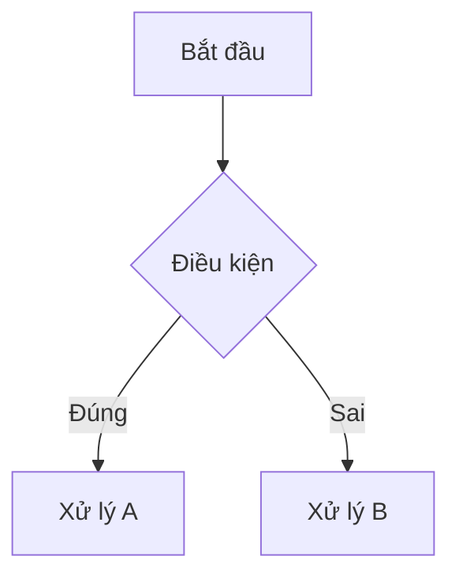

# Kỹ năng Lưu Trữ Tri Thức Nghiệp Vụ (/adam-save-kb & /save-kb)

Kỹ năng này giúp chuẩn hóa và lưu trữ các bài học, quy tắc logic nghiệp vụ sâu (Business Logic, Data Flows, Edge Cases) vào **Bộ Não Thứ 2** tại `docs/knowledge-base/` và tự động cập nhật vào bảng tra cứu `docs/knowledge-base/README.md`.

---

## 📋 Quy Trình Thực Hiện (Workflow)

### Bước 1: Thu thập & Phân tích Thông tin
AI tự động trích xuất các thông tin sau từ ngữ cảnh hội thoại hiện tại (hoặc hỏi lập trình viên nếu thiếu dữ liệu):
1. **Tiêu đề bài học (`title`)**: Ngắn gọn, nêu bật bản chất nghiệp vụ (Ví dụ: *"Cơ chế tính thuế theo Customer Tax Class"*).
2. **Domain nghiệp vụ (`domain`)**:
   - `inventory` (Mã prefix: `INV`)
   - `checkout-payment` (Mã prefix: `CHK`)
   - `pricing-tax` (Mã prefix: `PRC`)
   - `sync-offline` (Mã prefix: `SNC`)
   - `customer-loyalty` (Mã prefix: `CST`)
   - *Hoặc domain mới do người dùng đặt (lấy 3 chữ cái đầu viết hoa làm prefix).*
3. **Tags**: Các từ khóa tìm kiếm (Ví dụ: `[tax, customer-group, webpos]`).
4. **Tóm tắt cốt lõi (TL;DR)**: 2-3 gạch đầu dòng mô tả nguyên lý hoạt động.
5. **Bản đồ mã nguồn (Code Anchors)**: Đường dẫn file class/method Backend & Frontend liên quan.
6. **Sơ đồ Logic (Mermaid Flowchart)**: Thể hiện các nhánh rẽ và điều kiện if/else.
7. **Cạm bẫy & Trường hợp biên (Gotchas & Edge Cases)**: Các lỗi tiềm ẩn, ngoại lệ.
8. **Jira Issue / Commit liên quan** (nếu có).

---

### Bước 2: Sinh Mã Định Danh (ID Generation)
1. Đọc nội dung file `docs/knowledge-base/README.md` bằng `view_file`.
2. Kiểm tra các ID đã tồn tại với prefix của domain đó (Ví dụ: `KB-INV-001`, `KB-INV-002`).
3. Tăng số thứ tự để sinh ID mới (Ví dụ: `KB-INV-002` hoặc `KB-CHK-001` nếu domain chưa có bài nào).

---

### Bước 3: Tạo File Thẻ Tri Thức (Knowledge Card)
Tạo file mới tại: `docs/knowledge-base/<domain>/<kebab-case-title>.md` bằng công cụ `write_to_file`.

#### Cấu trúc mẫu chuẩn:
```markdown
---
id: <ID_VUA_SINH>
title: "<Tieu de bai hoc>"
domain: <domain>
tags: [<tag1>, <tag2>]
components:
  backend: [<Module_Name>]
  frontend: [<extension-name>]
updated_at: "<YYYY-MM-DD>"
related_jira: ["<ISSUE_KEY>"]
---

# <Tieu de bai hoc>

## 1. Tóm tắt Nghiệp vụ Cốt lõi (TL;DR)
- <Noi dung tom tat>

---

## 2. Bản đồ Mã Nguồn & Điểm Kích Hoạt (Code Tracing & File Anchors)

### Backend (Magento 2)
- `<Namespace\Class::method()>`: <Giai thich ngan>

### Frontend (WebPOS Client)
- `<path/to/file.js>` -> `<functionName>`: <Giai thich ngan>

---

## 3. Luồng Xử Lý & Sơ Đồ Logic (Logic Flow)



---

## 4. Các "Cạm Bẫy" & Trường Hợp Biên Cần Lưu Ý (Edge Cases & Gotchas)
1. **<Van de 1>**: <Cach phong tranh / xu ly>

---

## 5. Lịch Sử & Nguồn Gốc Bài Học (Origin & Tickets)
- **Ticket <ISSUE_KEY>**: <Ghi chu nguon goc>
```

---

### Bước 4: Cập Nhật Bảng Mục Lục README.md
1. Mở file `docs/knowledge-base/README.md`.
2. Tìm khối đánh dấu:
   ```markdown
   <!-- KB_INDEX_START -->
   ...
   <!-- KB_INDEX_END -->
   ```
3. Chèn thêm một dòng mới vào bảng:
   ```markdown
   | [<ID>](file:///home/bss/docs/knowledge-base/<domain>/<slug>.md) | **<Title>** | `<domain>` | `<Components>` | `<Main Anchor File>` | <YYYY-MM-DD> |
   ```
4. Lưu lại file `docs/knowledge-base/README.md` bằng `replace_file_content` hoặc `write_to_file`.

---

### Bước 5: Bàn Giao & Thông Báo
Gửi phản hồi xác nhận cho lập trình viên kèm đường link có thể click trực tiếp tới file bài học vừa tạo và bảng mục lục.
