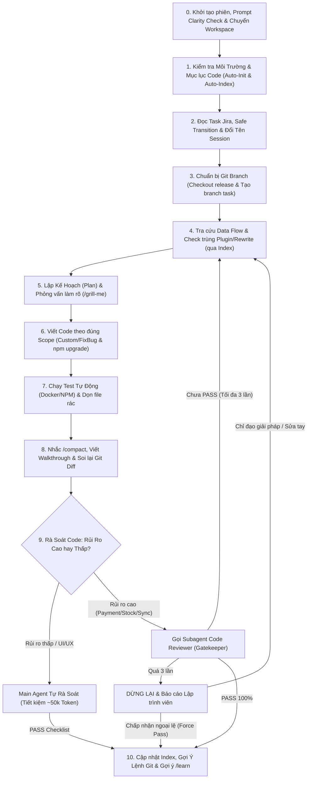

# User Workflow, Environment & Personal Goals Rules

## 1. Environment & Execution Setup
- **Project Root Location**: Các dự án mã nguồn của lập trình viên nằm tại các thư mục gốc chính bao gồm:
  `/mnt/projects/` (mặc định), `/var/www/` hoặc `/home/bss/` (ví dụ:
  `/mnt/projects/p1062-jw.com.au`, `/mnt/projects/p1115-cremagarage-com-au`, `/mnt/projects/study-ai-antigravity-skills`...).
  - AI BẮT BUỘC tra cứu đường dẫn dự án trực tiếp từ file rule `~/.agent/rules/project-mapping.md` (In-Memory Lookup).
  - Khi bắt đầu bất kỳ task nào, AI BẮT BUỘC đặt Cwd trực tiếp vào thư mục dự án tương ứng (ví dụ `/mnt/projects/<ma_du_an>-*`).
  - *(Quy định cấm chạy shell tại thư mục Home gốc `/home/bss`: xem `~/.agent/rules/workspace-search-priority.md`.)*

- **Frontend (WebPOS Client)**: Run directly using `npm` (`npm run upgrade`, `npm run test`...).
- **Backend (Magento 2 PHP)**: PHP is NOT installed on the host machine. All PHP/Magento CLI and PHP unit test
  commands MUST be run via Docker container (e.g. `docker exec ...`).

## 2. Task Initialization & Project Navigation Workflow
Whenever the user specifies a task ID to start working (e.g., `P1062-537`, `P1115-398` hoặc `bắt đầu issue ...`), AI
MUST strictly follow this sequence:

0. **Project Navigation, Workspace Switch, Prompt Clarity & Conversation Check**:
   - **Prompt Clarity Check (Bộ Lọc Rõ Ràng Đầu Vào)**:
     - Trước khi tra cứu code, AI đánh giá xem yêu cầu đã có mục tiêu, phạm vi và điều kiện đầu ra cụ thể chưa.
     - Nếu mơ hồ: Dừng lại hỏi làm rõ ngay, TUYỆT ĐỐI KHÔNG quét mò codebase.
   - **Định vị dự án & Tự động Chuyển Workspace (In-Memory Lookup & Fallback Auto-Scan)**:
     - Trích xuất mã dự án `{ma_du_an}` từ task ID (ví dụ: `P1062`, `P1115`, `PE4`...).
     - Tra cứu trực tiếp từ bảng ánh xạ `~/.agent/rules/project-mapping.md`:
       - **Nếu tìm thấy**: Sử dụng ngay đường dẫn thư mục dự án (0 lệnh shell).
       - **Nếu KHÔNG tìm thấy**: Tự động chạy `python3 ~/.agent/scripts/sync_project_mapping.py` để quét lại các thư mục gốc (`/mnt/projects/`, `/var/www/`, `/home/bss/`), cập nhật lại `project-mapping.md` và lấy đường dẫn mới nhất.
     - **BẮT BUỘC TỰ ĐỘNG CHUYỂN WORKSPACE & GÁN `Cwd`** sang thư mục dự án tương ứng ngay lập tức TRƯỚC KHI thực thi bất kỳ thao tác nào khác, nhằm tránh tác động đến các thư mục ngoài phạm vi.
   - **Tra cứu Conversation cũ (Auto-Resume Check)**: Kiểm tra danh sách Conversation History xem đã có phiên hội thoại
     nào trước đó liên quan đến mã task `{ma_du_an}-{ma_issue}` hay chưa.
     - **Nếu ĐÃ TỒN TẠI conversation cho issue này**: Ưu tiên gợi ý/mở tiếp conversation cũ để làm việc tiếp,
       kế thừa toàn bộ context và artifact đã có.
     - **Nếu CHƯA CÓ conversation**: Tiếp tục luồng xử lý trên workspace của dự án vừa chuyển.
1. **Environment & Index Setup (Hard Requirement: Auto-Init & Auto-Index)**:
   - Kiểm tra ngay lập tức sự tồn tại của `.agent` symlink và `docs/data-flows/INDEX.md` trong thư mục dự án vừa chuyển.
   - Nếu chưa có hoặc thiếu cấu hình $\rightarrow$ thực thi ngay:
     `ln -sf /mnt/projects/study-ai-antigravity-skills/.agent .agent && /mnt/projects/study-ai-antigravity-skills/scripts/index-refresh`.
   - **Ưu tiên Indexer**: Mọi thao tác tìm kiếm sau đó BẮT BUỘC tra cứu qua index file trước, không nạp toàn bộ file lớn vào context.
2. **Fetch Jira Task, Safe Transition & Session Renaming**:
   - Tra cứu task qua `jira_get_issue` lấy issue type (Bug / Story / Task), summary, description, comments, criteria.
   - **Xử lý trạng thái Jira:**
     - Nếu trạng thái là **`To Do`** (hoặc `Open`, `Backlog`): Tự động chuyển sang **`In Progress`** (hoặc `In Process`) qua `jira_transition_issue`.
     - Nếu trạng thái **KHÔNG PHẢI `To Do`** (đã là `In Progress`, `In Review`, `Done`...): **TUYỆT ĐỐI KHÔNG ĐƯỢC THAY ĐỔI TRẠNG THÁI**.
   - **Đổi tên Conversation (Session Renaming)**:
     - BẮT BUỘC đặt/đổi tên Conversation thành `{ma_du_an}-{ma_issue}-{noi_dung_task_tom_tat_20_ki_tu}`
       để đồng bộ 100% với tên file Plan và dễ dàng tìm kiếm/tiếp tục sau này.
3. **Git Branch Preparation & Baseline Sync**:
   - Kiểm tra branch hiện tại (`git status`, `git branch --show-current`).
   - Đảm bảo branch phát triển bắt đầu từ nhánh `release` sạch: `git checkout release && git pull origin release`.
   - Tạo branch mới chuẩn xác theo loại task từ Jira:
     - Nếu là Bug: `git checkout -b fix/{ma_du_an}-{ma_issue}-{noi_dung_task_tom_tat}`.
     - Nếu là Feature / Story / Task: `git checkout -b feature/{ma_du_an}-{ma_issue}-{noi_dung_task_tom_tat}`.
4. **Knowledge Retrieval & Conflict Audit via Index**:
   - Đọc đúng Data Flow liên quan đến domain của task (Payment, Cart, Reward...).
   - Mở `docs/data-flows/client/extension-plugins.md` / `extension-rewrites.md` đối soát xem method/class mục tiêu đã có extension nào can thiệp trước đó chưa (tránh xung đột logic mà không cần grep).
5. **Plan Creation, Clarification & Approval**:
   - Phỏng vấn làm rõ nếu yêu cầu mơ hồ (đặt 2–4 câu hỏi trắc nghiệm qua `/grill-me`).
   - Tạo tệp `Plans/{ma_du_an}-{ma_issue}-{noi_dung_task_tom_tat_20_ki_tu}.md` và artifact `implementation_plan.md`.
   - **Chờ User duyệt (Approve) mới được bắt đầu viết code.**
6. **Code Implementation (Strict Scope)**:
   - Triển khai code trong vùng cho phép (`*Custom*`, `*FixBug*` / `src/extension/`).
   - Nếu tạo module extension WebPOS mới: Bắt buộc chạy `npm run upgrade` để đăng ký vào `modules.json`.
7. **Automated Testing & Artifact Cleanup**:
   - Chạy test tự động qua Docker container (`docker exec phpunit`) hoặc NPM.
   - **Bắt buộc tự động xóa bỏ toàn bộ file test tạm thời trước khi chuyển bước.**
8. **Walkthrough & Git Diff Verification (Kèm Gợi ý /compact)**:
   - **Chủ động nhắc /compact**: Trước khi xuất bản tài liệu dài `walkthrough.md`, AI gợi ý người dùng gõ `/compact` để giải phóng context window.
   - Ghi nhận kết quả thực thi vào `walkthrough.md`.
   - Tự rà soát `git diff` đảm bảo: Dòng code <= 120 ký tự, Copyright Header, Thẻ XML match 100%.
9. **Code Review & Architecture Audit (Conditional Subagent Trigger)**:
   - **Phân loại Task để kích hoạt Reviewer**:
     - **Nhóm 1 - Rủi ro cao (BẮT BUỘC gọi Subagent `Code Reviewer & Architecture Auditor`)**:
       * Can thiệp Thanh toán (Payment, Checkout, Payment Terminals).
       * Can thiệp Tồn kho & Đơn hàng (Inventory, Stock deduction, Order placement/refund).
       * Can thiệp Đồng bộ ngoại tuyến & CSDL (IndexedDB Sync, Realtime Reindex, Direct SQL queries).
       * Override/Rewrite Core Framework API.
     - **Nhóm 2 - Task thông thường / Rủi ro thấp (TỐI ƯU TOKEN: Main Agent Self-Check)**:
       * Các task UI/UX, chỉnh sửa CSS, đổi layout text, thêm filter grid, fix validation form đơn giản.
       * Main Agent tự đối soát diff trực tiếp theo Checklist chuẩn (độ dài dòng <= 120, escape XML, null-pointer) mà KHÔNG cần spawn Subagent riêng, tiết kiệm ~50.000 tokens.
   - **Điều kiện Chuyển Tiếp & Cơ chế Ngắt Vòng Lặp (Gatekeeper & Circuit Breaker Rule):**
     - **Nếu Review kết luận CHƯA PASS** (phát hiện lỗi logic, rủi ro bảo mật, memory leak, hoặc vi phạm coding standards):
       - **Lặp lại tối đa 3 lần (Max 3 Retries)**: Bắt buộc quay lại từ **Bước 4** (Đối soát Data Flow, cập nhật Plan, sửa code và test lại từ đầu).
       - **Kích hoạt Circuit Breaker (Khi đã lặp lại quá 3 lần vẫn KHÔNG PASS)**:
         1. **DỪNG NGAY LẬP TỨC**: Tuyệt đối không tự ý lặp lại lần thứ 4 và không được kết thúc task.
         2. **Báo cáo Bế tắc (Escalation Report)**: Gửi báo cáo chi tiết cho lập trình viên gồm lỗi cụ thể, các cách sửa đã thử và 2-3 đề xuất.
         3. **Chờ chỉ đạo của Lập trình viên**: Sửa theo chỉ đạo hoặc lập trình viên xác nhận ngoại lệ (Force Pass) mới được chuyển tiếp.
     - **Nếu kết luận PASS 100%**: Chuyển sang Bước 10.
10. **Index Refresh, Git Command Suggestion & Proactive Learning**:
    - Chỉ thực hiện khi đã vượt qua vòng kiểm duyệt (PASS 100%) tại Bước 9.
    - **Tự động cập nhật Bộ Index**: Bổ sung Plugin/Rewrite/Class mới vào `docs/data-flows/` hoặc chạy script làm mới index để tránh stale index cho các phiên sau.
    - **Chỉ xuất khối gợi ý lệnh Git (Git Suggestion Block)**: AI tạo sẵn khối lệnh Git hoàn chỉnh (bao gồm `git add`, `git commit` đúng format chuẩn dự án, và `git push origin <branch>`), KHÔNG tự chạy trong terminal. Người dùng chỉ cần copy/paste chạy ở terminal cá nhân.
    - Đề xuất chạy `/learn` nếu task có bài học/kinh nghiệm quý cần ghi nhớ.

## 3. Communication & Clarification Mandate
- **Strict Clarification Rule**: Always ask the user directly for clarification whenever a requirement, design
  detail, error log, or task description is ambiguous, missing, or unclear. Never make blind assumptions or patch
  symptoms silently.

## 4. Automation & Code Optimization Objectives
- **Phase 1 (Time & Workflow Optimization)**: Maximize automation in daily tasks (auto-tracing, proactive subagents,
  docker/npm testing, self-review, handover notes).
- **Phase 2 (WebPOS Codebase Audit & Performance Optimization)**: Proactively observe and audit WebPOS
  client/backend code during tasks to identify bottlenecks, race conditions, offline IndexedDB sync issues, or
  anti-patterns, and propose refactoring/optimization recommendations.

## 5. Quy định Đánh giá & Đề xuất Cải tiến Có Điều kiện (Selective Continuous Improvement Rule)
- **Đánh giá ngầm Bắt buộc (Mandatory Internal Evaluation)**: Sau khi hoàn thành triển khai mã nguồn và kiểm thử cho
  mỗi task, AI BẮT BUỘC phải tự động đánh giá lại toàn bộ quá trình thực hiện theo 3 tiêu chuẩn:
  1. *Có pattern mới đáng giá cần đóng gói thành Skill hoặc mở rộng tài liệu không?*
  2. *Bộ nhớ / Rules / Tools hiện tại có điểm nào gây cản trở, mâu thuẫn hoặc lãng phí Token không?*
  3. *Quy trình vừa thực hiện có thao tác thủ công lặp lại nào có thể tự động hóa bằng Script / Slash Command không?*
- **Đề xuất Có Điều kiện (Conditional Proposal)**:
  - **Nếu hệ thống đã tối ưu**: Hoàn thành task bình thường, bàn giao súc tích, **TUYỆT ĐỐI KHÔNG sinh chữ thừa hay đề xuất
    sáo rỗng làm loãng thông tin**.
  - **Nếu phát hiện điểm nghẽn hoặc cơ hội cải tiến thực sự**: Chủ động đưa ra 1-2 đề xuất ngắn gọn, trực diện kèm giải
    pháp xử lý cụ thể để cùng lập trình viên tinh chỉnh hệ thống.
