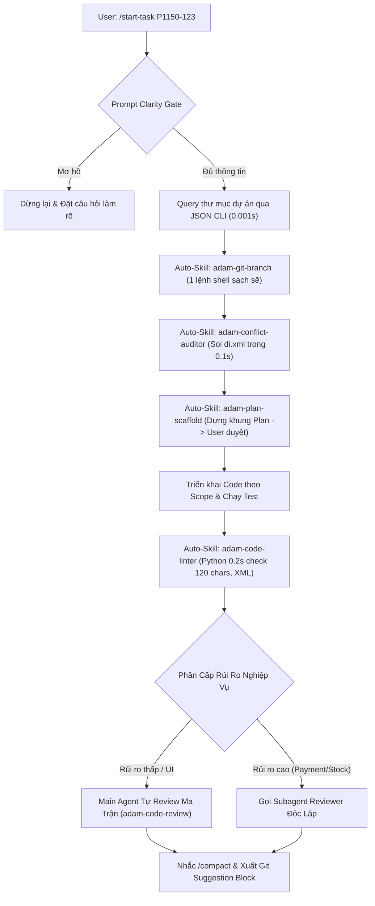

# 🚀 GIẢI PHẪU CHI PHÍ TOKEN
## & Hành Trình Tối Ưu Hóa Toàn Diện Workflow `/start-task`

- **Diễn giả**: Đội ngũ Phát triển WebPOS & AI Core Architecture
- **Mục tiêu**: Bóc tách chi tiết cơ chế tiêu hao token, mổ xẻ từng bước của quy trình cũ, lý giải nguyên nhân giải pháp và trình diễn workflow tự động hóa mới.
- **Thời lượng dự kiến**: 30 – 45 phút chia sẻ kỹ thuật chuyên sâu

---

## 📑 MỤC LỤC NỘI DUNG CHIA SẺ

1. **Phần I: Bản Chất Kỹ Thuật Của Cơ Chế Tiêu Hao Token** (Slide 3 – 5)
   - Hiểu lầm phổ biến & Cơ chế Cumulative Context trong LLM Agent.
   - Tại sao một lệnh thừa ở cuối phiên tốn gấp 10 lần đầu phiên?
2. **Phần II: Mổ Xẻ Quy Trình Cũ & 4 "Tội Đồ" Gây Cháy Token** (Slide 6 – 10)
   - Bảng tĩnh 115 dòng, lạm dụng Subagent, chuỗi lệnh Git và Prompt mơ hồ.
3. **Phần III: Hành Trình Cải Thiện & 5 Đòn Bẩy Kiến Trúc Mới** (Slide 11 – 16)
   - Prompt Clarity Gate, JSON CLI Query, Deterministic Linter, Chuyển Rules sang Skills, Review Matrix, Git Suggestion.
4. **Phần IV: Bức Tranh Toàn Cảnh Của Workflow Mới** (Slide 17 – 18)
   - Sơ đồ Pipeline tự động hóa & Cơ chế ép buộc 2 tầng.
5. **Phần V: Tổng Kết Số Liệu & 4 Bài Học Đắt Giá** (Slide 19 – 21)
   - Bảng đối soát chi tiết & Nguyên lý phát triển cùng AI Agent.

---

## ❓ Slide 3: Hiểu Lầm Tai Hại Về Cách Tính Token

Hầu hết lập trình viên khi mới dùng AI Agent thường có một giả định sai lầm:

> *"Tôi chỉ hỏi AI một câu: 'Hãy commit code giúp tôi'. Câu đó chỉ có 7 từ, cùng lắm AI trả về 20 từ. Tại sao dashboard lại báo mất tới **80.000 tokens**?"*

### Thực Tế Phía Sau:
- AI Agent **không có bộ nhớ dài hạn độc lập** như con người.
- Để AI có thể "nhớ" được bạn đang làm task gì, sửa file nào, container nào đang chạy... mỗi khi bạn gửi 1 câu hỏi, hệ thống phải **đóng gói lại toàn bộ quá khứ** và gửi lên máy chủ AI.

---

## 🔄 Slide 4: Cơ Chế "Cumulative Context" (Ngữ Cảnh Tích Lũy)

Mỗi lượt tương tác (Turn) hoặc một thao tác công cụ (Tool Call), lượng Token đầu vào (Input Tokens) được tính bằng:

$$\text{Total Tokens} = \text{System Prompt} + \text{Rules} + \text{Lịch sử trò chuyện} + \text{Output các lệnh Terminal trước} + \text{Diff code}$$

```
Turn 1 (Khởi tạo)     : [System Prompt + Rule]                          ~ 12.000 tokens
Turn 5 (Nghiên cứu)   : [Turn 1] + [Data flows + Lệnh grep/find]        ~ 35.000 tokens
Turn 10 (Sinh code)   : [Turn 5] + [File code cũ + Code mới sinh]       ~ 60.000 tokens
Turn 15 (Chạy test)   : [Turn 10] + [Log test container + Output test]  ~ 85.000 tokens
Turn 20 (Commit Git)  : [Turn 15] + [Toàn bộ git diff tích lũy]        ~ 110.000 tokens!
```

👉 **Mỗi 1 câu lệnh terminal được gọi ở Turn 20 sẽ kéo theo toàn bộ 110.000 tokens của quá khứ đi kèm!**

---

## 📈 Slide 5: Quy Luật "Chi Phí Leo Thang Theo Thời Gian"

Biểu đồ trực quan hóa chi phí Token qua các giai đoạn của một phiên làm việc:

```
Token Cost
   ▲
120k│                                                 ╭── [Giai đoạn cuối: Git & Review]
100k│                                           ╭─────╯   (Mỗi lệnh shell tốn 100k tokens!)
 80k│                                     ╭─────╯
 60k│                               ╭─────╯ [Giai đoạn code & chạy test]
 40k│                         ╭─────╯
 20k│                   ╭─────╯ [Giai đoạn nghiên cứu & grep]
  0k└─────┬─────────────┬─────────────┬─────────────┬─────────────►
        Turn 1        Turn 5        Turn 10       Turn 15       Turn 20
```

> <span class="highlight">Kết luận cốt lõi</span>: Tiết kiệm token không phải là nói ngắn đi, mà là **cắt giảm số lượt gọi Tool không cần thiết, đặc biệt là ở nửa sau của phiên làm việc!**

---

## 🕸️ Slide 6: Mổ Xẻ Workflow `/start-task` Ban Đầu (Quy Trình Cũ)

Hãy nhìn lại chuỗi mắt xích đầy rủi ro mà chúng ta từng vận hành:

```
[Bắt đầu /start-task P1115-401]
   │
   ├─► 1. Đọc bảng mapping tĩnh 115 dòng trong rules/ để tìm đường dẫn thư mục
   ├─► 2. Gọi liên tiếp 4 lệnh shell để checkout git (status -> fetch -> checkout -> pull)
   ├─► 3. Prompt mơ hồ ("fix lỗi discount") -> AI tự động grep khắp cả trăm file Core
   ├─► 4. Đọc tràn lan cả file 800 - 1000 dòng bằng view_file
   ├─► 5. Viết code & chạy test
   ├─► 6. BẮT BUỘC GỌI SUBAGENT REVIEW ĐỂ ĐẾM DÒNG 120 KÝ TỰ & SOI THẺ XML!
   └─► 7. AI tự chạy chuỗi 4 lệnh terminal: git status -> diff -> add -> commit -> push
[TỔNG TIÊU HAO: 180.000 – 250.000 TOKENS CHO MỘT TASK SỬA BUG NHỎ!]
```

---

## 💣 Slide 7: Tội Đồ #1 — Bảng Mapping Tĩnh 115 Dòng Trong `rules/`

### Thực trạng:
- File `rules/project-mapping.md` liệt kê danh sách toàn bộ 68+ dự án trên máy (`P141`, `P153`, `P1115`...).
- Vì nằm trong thư mục `rules/`, file này trở thành **Global System Rule**, nghĩa là:
  **Nó được nạp thẳng vào đầu ngữ cảnh của 100% mọi câu hỏi và mọi turn!**

### Hậu quả về chi phí:
- File dài 115 dòng tương đương **~1.500 tokens**.
- Một task trung bình kéo dài 15 lượt gọi tool:
  $$1.500 \text{ tokens} \times 15 \text{ turns} = 22.500 \text{ tokens lãng phí!}$$
- Bạn mất 22.500 tokens chỉ để AI "ngắm" danh sách 67 dự án khác hoàn toàn không liên quan đến task hiện tại!

---

## 💣 Slide 8: Tội Đồ #2 — Lạm Dụng Subagent Để Đếm Ký Tự

### Thực trạng:
- Rule cũ quy định: *Sau khi code xong, bắt buộc 100% phải gọi Subagent `Code Reviewer & Risk Analyst`*.
- Kể cả một task đổi màu nút bấm, sửa 1 dòng CSS hay đổi 1 đoạn text label cũng phải kích hoạt Subagent!

### Hậu quả về chi phí:
- Khởi tạo Subagent nghĩa là tạo ra một phiên LLM mới:
  - Nạp lại System Prompt khổng lồ (~12.000 tokens).
  - Nạp toàn bộ git diff và các file liên quan (~15.000 tokens).
  - Subagent đọc từng dòng chỉ để kiểm tra: *Dòng này có quá 120 ký tự không? Thẻ `<type>` có thẻ `</type>` chưa?*
- **Tiêu tốn từ 40.000 – 60.000 tokens** và mất gần 1 phút chỉ để làm công việc của một chương trình linter cơ bản!

---

## 💣 Slide 9: Tội Đồ #3 — AI Tự Chạy Chuỗi Lệnh Git Cuối Task

### Thực trạng:
- Khi hoàn thành code và test, AI tự động thực thi chuỗi lệnh quản trị Git:
  1. `git status -s` (Turn 18)
  2. `git diff` (Turn 19 — in ra hàng trăm dòng diff vào context)
  3. `git add <files>` (Turn 20)
  4. `git commit -m "..."` (Turn 21)
  5. `git push origin <branch>` (Turn 22)

### Hậu quả về chi phí:
- Ở Turn 18–22, context window đã đạt đỉnh (**80.000 – 100.000 tokens / turn**).
- Việc chạy 5 lệnh terminal này làm context luân chuyển thêm 5 lần:
  $$5 \text{ turns} \times 90.000 \text{ tokens} \approx \mathbf{450.000 \text{ token-turns luân chuyển!}}$$
- Đây chính là thủ phạm âm thầm "đốt sạch" ngân sách token của bạn vào những phút cuối cùng!

---

## 💣 Slide 10: Tội Đồ #4 — Quét Mò Codebase Khi Prompt Mơ Hồ

### Thực trạng:
- Lập trình viên gửi prompt ngắn: *"Xem giúp tôi lỗi tính giá của Webpos"*.
- AI không có cơ chế chặn, lập tức kích hoạt các tool:
  - `grep_search` từ khóa `"price"` $\rightarrow$ Trả về 200 kết quả làm rác context.
  - `view_file` mở hàng loạt file Core trong `src/pos/` để đọc mò mẫm.
  - Sau 5 lượt tìm kiếm không thấy, context đã phình to thêm **40.000 tokens** mà chưa viết được dòng code nào!

### Nguyên nhân gốc rễ:
- Hệ thống thiếu một **Bộ Lọc Cửa Vào (Ingress Gate)** để buộc AI phải dừng lại hỏi làm rõ trước khi hành động.

---

## 🛠️ Slide 11: Đòn Bẩy #1 — Prompt Clarity Gate (Chặn Tại Cửa Vào)

Để triệt tiêu việc AI quét mò mã nguồn khi nhận yêu cầu mơ hồ:

### Cơ chế hoạt động:
Tại Bước 0 của quy trình, AI bắt buộc đối soát Prompt qua **3 Tiêu Chí Bắt Buộc**:
1. Đã có **mục tiêu cụ thể** chưa? (Sửa bug gì, ở module nào?)
2. Đã có **điều kiện đầu ra** rõ ràng chưa? (Hành vi mong muốn sau khi sửa?)
3. Đã có **ngữ cảnh tối thiểu** chưa? (Mã issue, màn hình xảy ra lỗi, file nghi vấn?)

```
Prompt: "Sửa giúp tôi lỗi nút thanh toán"
   │
   ▼ [Prompt Clarity Gate]
   ❌ Thiếu thông tin module & điều kiện lỗi!
   │
   ▼ AI DỪNG LẠI NGAY LẬP TỨC & DÙNG ask_question:
   "Nút thanh toán bị lỗi ở màn hình WebPOS hay Admin? Lỗi không bấm được hay bấm báo lỗi gì?"
```
👉 <span class="highlight">Tiết kiệm 30.000 – 50.000 tokens tìm kiếm vô định!</span>

---

## 🛠️ Slide 12: Đòn Bẩy #2 — Di Dời Bảng Tĩnh Ra Khỏi Rules

### Giải pháp kỹ thuật:
- **Xóa bỏ hoàn toàn** `rules/project-mapping.md` khỏi thư mục rules.
- Chuyển toàn bộ danh sách 68 dự án vào cơ sở dữ liệu JSON: `scripts/data/projects.json`.
- Viết kịch bản truy vấn cực nhanh qua Python CLI:
  ```bash
  python3 scripts/sync_project_mapping.py query P1115
  # Output ngay lập tức: /mnt/projects/p1115-cremagarage-com-au (0.001s)
  ```

### Tác động trực tiếp:
- **Cắt giảm vĩnh viễn 1.500 tokens trên MỌI lượt tương tác**.
- Một phiên chat 15 turns tiết kiệm ngay lập tức **~22.500 tokens** mà không làm thay đổi bất kỳ hành vi logic nào của dự án!

---

## 🛠️ Slide 13: Đòn Bẩy #3 — Deterministic Skill Thay Thế Subagent

> <span class="accent">Nguyên lý vàng trong AI Engineering</span>: **Việc gì có thể giải quyết bằng Script và Thuật toán thì TUYỆT ĐỐI KHÔNG dùng LLM!**

### Xây dựng Skill `adam-code-linter`:
- Viết script Python siêu nhẹ `my-skills/adam-code-linter/scripts/lint_diff.py`:
  1. Đo độ dài từng dòng trên git diff $\le 120$ ký tự (tính cả khoảng trắng thụt lề).
  2. Parse cú pháp XML bằng `xml.etree.ElementTree` để đảm bảo 100% thẻ mở có thẻ đóng.
  3. Kiểm tra sự tồn tại của `declare(strict_types=1);` và Magestore Copyright Header.
  4. Kiểm tra ký tự kết thúc tệp (EOF) chỉ có đúng 1 dòng trống.

```bash
python3 my-skills/adam-code-linter/scripts/lint_diff.py
# Output trong 0.2s: ✅ ALL FILES PASSED CODING STANDARDS LINTER!
```
👉 <span class="highlight">Tốc độ: 0.2 giây | Chi phí token: 0 | Tiết kiệm: ~50.000 tokens/task!</span>

## 🛠️ Slide 14: Tại Sao Chuyển Từ "Rules" Sang "Skills" Giúp Tiết Kiệm Token?

Đây là một phát hiện kiến trúc cực kỳ quan trọng trong Antigravity:

| Tiêu chí | **RULE (`rules/*.md`)** | **SKILL (`my-skills/*`)** |
| :--- | :--- | :--- |
| **Cơ chế nạp Context** | **Luôn luôn nạp vào System Prompt** của MỌI câu chat và MỌI turn (Eager / Static Injection). | **Chỉ nạp khi cần dùng** (Lazy Loading / Just-In-Time Execution). |
| **Mức độ chiếm dụng** | Nếu rule dài 2.000 từ $\rightarrow$ **Mỗi lượt chat mất thêm 2.000 tokens**. | Trả trước **0 token** cho đến khi task thực sự cần kích hoạt. |
| **Bản chất phù hợp** | Các luật bất biến ngắn gọn (cấm sửa Core, tiếng Việt, strict_types). | Các kịch bản nhiều bước, workflow phức tạp, checklist, script công cụ. |

> <span class="highlight">Bí kíp tối ưu</span>: **Rút gọn Rules thành các mệnh lệnh ngắn**, chuyển toàn bộ kịch bản triển khai và script xử lý sang **Skills**.
> $\rightarrow$ Ngăn chặn hiện tượng "Phình to System Prompt" (System Prompt Bloat).

---

## 🛠️ Slide 15: Đòn Bẩy #4 — Phân Cấp Review (Conditional Trigger)

Không phải task nào cũng cần gọi Subagent tốn kém. Chúng ta phân định rủi ro rõ ràng qua **Ma Trận `adam-code-review`**:

### 1. Nhóm Task Rủi Ro Thấp (UI/UX, CSS, Label, Filter Grid, Validation form):
- **Main Agent Tự Rà Soát (Self-Check)** qua 6 chốt chặn:
  - Constructor backward compatibility (`?TypeInterface $param = null`).
  - Chống SQL Injection (`quoteInto`), chặn N+1 query trong loop.
  - Extension Attributes không gọi `getData/setData`.
  - Không để catch rỗng (`Empty catch block`).
- 👉 **PASS Ma Trận $\rightarrow$ Chuyển bước ngay, KHÔNG gọi Subagent! (Tiết kiệm ~50.000 tokens)**

### 2. Nhóm Task Rủi Ro Cao (Payment, MSI Tồn kho, Sync Offline, Realtime Reindex):
- **BẮT BUỘC gọi Subagent `Code Reviewer & Architecture Auditor`** làm chốt chặn kiểm toán độc lập.

---

## 🛠️ Slide 16: Đòn Bẩy #5 — Git Suggestion Block Thay Vì Chạy Terminal

### Thay đổi tư duy:
- Thay vì để AI chạy 5 lượt lệnh terminal ở cuối phiên (khi context nặng 100k tokens), AI chuyển sang vai trò **Người soạn thảo lệnh (Command Composer)**.

### Định dạng đầu ra:
AI in ra một khối code duy nhất kèm hướng dẫn:
```bash
git add app/code/Magestore/WebposFixBug/Model/Payment/Processor.php
git commit -m "fix(webpos): resolve discount calculation for tyro terminal"
git push origin fix/P1150-123-fix-discount
```
- Lập trình viên chỉ cần nhấn nút Copy và dán vào terminal cá nhân.
- Trước khi xuất file `walkthrough.md`, AI nhắc bạn gõ `/compact` để dọn sạch context.
👉 <span class="highlight">Tiết kiệm 100% token cho toàn bộ khâu Git cuối phiên (tiết kiệm 25k - 40k tokens)!</span>

---

## 🌟 Slide 17: Bức Tranh Workflow `/start-task` Mới Hiện Tại

Toàn bộ hệ thống giờ đây vận hành như một **Dây Chuyền Tự Động Hóa Khép Kín**:



---

## 🔒 Slide 18: Hai Tầng Ép Buộc Tự Động (Hard Enforcement)

Làm sao đảm bảo AI không bao giờ "quên" chạy các Skills này? Chúng ta thiết lập cơ chế 2 tầng:

### Tầng 1: Hard Rules Trong `rules/user-workflow-and-goals.md`
- Từng bước được ghi rõ thành **Luật Bất Biến**:
  - *Bước 3: BẮT BUỘC gọi `adam-git-branch`.*
  - *Bước 4: BẮT BUỘC gọi `adam-conflict-auditor`.*
  - *Bước 5: BẮT BUỘC dùng `adam-plan-scaffold`.*
  - *Bước 8: BẮT BUỘC chạy `adam-code-linter`.*
  - *Bước 9: BẮT BUỘC đối soát qua `adam-code-review`.*

### Tầng 2: Executable Playbook Trong `workflows/start-task.md`
- Kịch bản slash command `/start-task` nhúng thẳng cú pháp dòng lệnh chính xác của từng Skill, AI chỉ việc thực thi theo kịch bản có sẵn.

---

## 📊 Slide 19: Bảng So Sánh Số Liệu Thực Tế: Cũ vs. Mới

| Hạng Mục So Sánh | Quy Trình Ban Đầu (Cũ) | Quy Trình Tối Ưu (Mới) | Mức Tiết Kiệm Đạt Được |
| :--- | :--- | :--- | :---: |
| **System Prompt nạp sẵn** | ~6.500 tokens (kèm bảng tĩnh 115 dòng) | ~5.000 tokens (lấy qua CLI JSON) | **Giảm 1.500 tokens / turn** |
| **Khâu Tiếp Nhận Prompt** | Quét mò codebase làm tràn 30k-40k tokens | **Prompt Clarity Gate**: Hỏi lại ngay | **Tiết kiệm 30.000 – 40.000 tokens** |
| **Khâu Rẽ Nhánh Git** | 3-4 lệnh shell (`status`, `fetch`, `checkout`) | 1 lệnh script `adam-git-branch` | **Giảm 60% tokens** |
| **Khâu Soi Xung Đột** | Grep thủ công quét diện rộng | 1 lệnh `adam-conflict-auditor` (0.1s) | **Giảm 75% tokens** |
| **Khâu Lập Plan** | Tự gõ cấu trúc Markdown từ đầu | `adam-plan-scaffold` dựng sẵn khung | **Tiết kiệm token "sáng tác" format** |
| **Khâu Kiểm Tra Chuẩn Code** | Bắt Subagent đọc diff đếm 120 ký tự | Script Python `adam-code-linter` (0.2s) | **Tiết kiệm ~50.000 tokens** |
| **Khâu Review Code** | 100% mọi task đều gọi Subagent | Phân cấp: Task thường tự review | **Tiết kiệm ~50.000 tokens** (task thường) |
| **Khâu Git Cuối Task** | AI tự chạy chuỗi lệnh terminal (4-5 turns) | Git Suggestion Block | **Tiết kiệm 100% token Git** |
| **TỔNG TOKEN / 1 TASK** | **150.000 – 250.000 tokens** | **40.000 – 60.000 tokens** | <span class="highlight">CẮT GIẢM 60% – 70%! 🚀</span> |

---

## 💎 Slide 20: Bốn Bài Học Đắt Giá Trong Kỹ Thuật Agentic Coding

1. **Chuyển Hóa Rules Thành Skills (Lazy Loading)**:
   - Giữ Rules ngắn gọn làm "Hiến pháp". Đóng gói quy trình hành động thành Skills để chỉ nạp khi kích hoạt.
2. **Nguyên Lý Xác Định (Determinism vs. Reasoning)**:
   - Các tác vụ cú pháp, đếm ký tự, format, parsing XML phải giao cho **Script Python/Regex**, không dùng LLM!
3. **Phân Cấp Quyền Lực Cho Subagent**:
   - Subagent là một phiên hội thoại mới rất đắt đỏ. Chỉ triệu hồi khi đối mặt với bài toán rủi ro cao (Payment, Inventory, Security).
4. **Chặn Lỗi Ngay Tại Cửa Vào (Clarity First)**:
   - Dành 30 giây để hỏi rõ người dùng sẽ tiết kiệm được 30 phút và 50.000 tokens mò mẫm sai hướng.

---

# 💬 CẢM ƠN MỌI NGƯỜI ĐÃ LẮNG NGHE!
### Q&A & Thảo Luận Kỹ Thuật
- **Kho lưu trữ Rules & Skills**: `/mnt/projects/study-ai-antigravity-skills/`
- **Tài liệu tham khảo**: `docs/knowledge-base/agent-optimization/token-and-cost-optimization-architecture.md`
